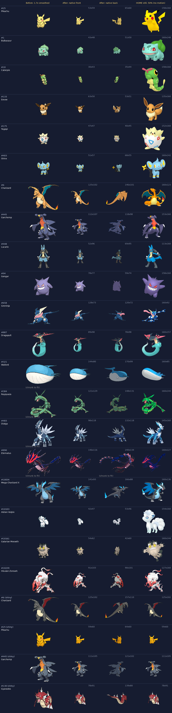
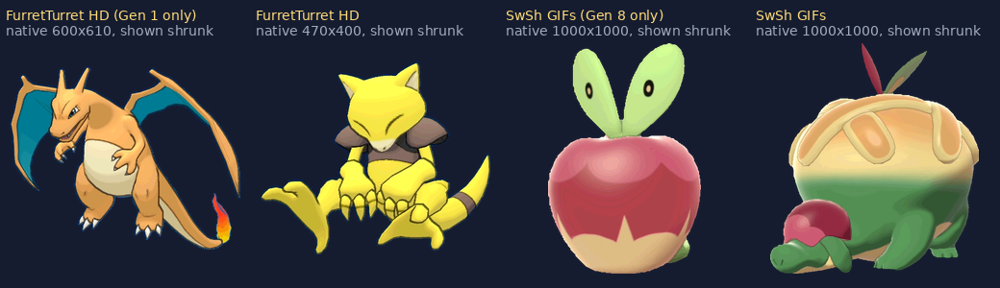

# 3D sprites: research, decision and gaps (Phase 4)

Blake's brief: the 3D sprites must be **moving, animated sprites** from a real source, shown **without being resized
or filtered**, the same way the 2D ones are.

## What was wrong before

The 3D packs were already Pokémon Showdown's animated model renders. They are small: the median sprite is
**73 px tall** and the tallest is 195 px. The app enlarged them, for example 1.7× in the View team and up to 82% of
the battle field. It then smoothed the result with an xBR filter (`hqFrame`), and that softened, filtered look is
what didn't work.

## Sources checked

Hosts reachable from this build environment: GitHub and npm. Project Pokémon, play.pokemonshowdown.com,
FurretTurret, eeveeexpo and pokemondb are blocked, so those were judged from their public descriptions and from
GitHub mirrors.

| Source | Native size | Animated? | Frames | Coverage (app: 1,025 + 157 forms) | Shiny | Back | Format / size | Terms |
|---|---|---|---|---|---|---|---|---|
| **Pokémon Showdown `ani` / `ani-back`** (via [PokéAPI sprites](https://github.com/PokeAPI/sprites), `other/showdown`) | 30–240 px (median 73 px front) | Yes, idle loops rendered from the 3DS/Switch models | median 58 | **1,128 of 1,182** (all but 54 late Gen 9 / new forms) | Yes | **Yes** (1,128) | GIF, ~78 MB per set | Fan use with credit to Showdown's spriters (already credited) |
| FurretTurret HD 3D sprites ([Gen 1 mirror](https://github.com/Nackha1/Hd-sprites)) | 400–600 px | Yes, 30 fps | 48–80 | Gen 1 only in any reachable copy (187 sprites) | Partly | No | GIF, 1.5–2 MB each | Credit required; **rehosting for download is not allowed** without the author's permission |
| [Sword/Shield GIFs](https://github.com/dokkanart/swsh-gifs) | 1000 × 1000 | Yes | 60–120 | Gen 8 only (~100 species) | Yes | No | GIF, 1–5 MB each | No license stated |
| [Pokémon 3D models](https://github.com/Pokemon-3D-api/assets) (GLB) | any (we'd render them) | Only one random clip per model (Charizard "dizzy", Pikachu "thunderbolt", Garchomp none) | n/a | 974 species + 182 forms | 150 only | n/a | GLB | Repo MIT; the models are game rips |
| Smogon sprite project `previews/gen8–9` | ~300 px | **No** (stills) | 1 | Gen 8–9 | Yes | No | PNG | Smogon credit |
| Pokémon HOME renders (our `h` packs) | 320 px | **No** (stills) | 1 | All | No | No | WebP | Already credited; Blake rejected stills |
| Project Pokémon sprite index | 3DS-scale animated renders (same family as Showdown's) | Yes | – | – | – | – | GIF | Blocked here |
| [Battlers – Animated 3D Sprites Gen 1–8](https://eeveeexpo.com/resources/825/) | Showdown-sized | Yes | – | Gen 1–8, uses 2D where a 3D render is missing | Yes | Yes | GIF | Blocked here; a repack of the sources above |

No public collection has animated renders at 200 px or more for every Pokémon. The large ones are partial (Gen 1 or
Gen 8 only). FurretTurret's set also may not be hosted on a website without permission, and the 3D models don't come
with idle animations or most shiny textures.

## Contact sheet

Pokémon sizes, in order: small (Pikachu to Shinx), medium (Charizard to Dragapult), huge (Wailord to Eternatus).
Then four forms and four shinies. First frame of each animation, against the app's background colour.

- **Before** shows the old View-team treatment (1.7× enlarged and smoothed).
- The **After** columns are the files exactly as they are stored and shown now.
- **HOME still** (shown at 50%) is for comparison only; it doesn't move. In the shiny rows that column repeats the
  3D shiny, because HOME stills have no shiny set.
- Hisuian Zoroark (#10239) stands in for "special forms". The app has no Gigantamax forms, so none are shown.

The large alternatives, shrunk to fit the page:

## Decision

The roadmap said to stop and ask Blake here. He had asked me to keep going without pausing, so I made the call and
recorded it here:

**Keep Pokémon Showdown's animated model renders. Show them exactly as made: native size, never filtered. Add
Showdown's animated back sprites for the player's side in battle.**

- They are the only set that moves *and* covers almost every Pokémon, form and shiny, with back sprites too.
- Blake asked for sprites "out there the same as the 2D ones" and not resized. These are the files as published,
  byte for byte.
- The bigger sets would mean mixing styles generation by generation, or hosting files we may not host.

### How sprites are shown now

- **Pages (Team Builder, View team, Pokédex, quiz, cards):** an `` at its natural size. A sprite only gets
  smaller (never larger) when it doesn't fit its box. The 1.7× View-team zoom is gone.
- **Battles:**
  - The foe uses its front sprite at native size. The old rule that stretched sprites to 82% of the field is gone.
  - Your Pokémon uses its real **animated back sprite** (`3db` / `3dbs` packs).
  - If a Pokémon has no back sprite, the front sprite is mirrored, as before.
- **Hall of Fame canvas:**
  - 1 sprite pixel = 1 canvas pixel on a stage 540 px tall.
  - Bigger stages use a whole-number multiple (2×, 3×) with smoothing off, so pixels stay sharp and are never
    filtered.
  - Small previews (gallery cards) are only ever shrunk.
  - A player's own size slider snaps to the whole number when it's close.
  - HOME stills, which a player can still pick per Pokémon in the scene editor, keep their height-based size and are
    never enlarged.
- **Pokémon Home:** the same rule against the tile size (`natK(HS.ts, 40)`). Only giants like Wailord are shrunk to
  fit a room.
- **Code:**
  - The xBR upscaler is removed completely: `xbrFactory`, the worker pool, `hqFrame` / `hqSync` / `hqLoop`, the
    `data-hq` attribute and the `.spr-hq` / `.hq-off` CSS.
  - `natK()` and `hasBack()` replace them, in the section now called `SPRITES AT NATIVE SIZE`.

## Packs

- `scripts/gen_back_packs.py` builds `packs/s/3db-*.wasm` and `3dbs-*.wasm` (forms in `-f*`) from PokéAPI's mirror of
  Showdown's `ani-back`. The GIFs are copied byte for byte.
- The packs use the same grouping as the front packs, so `spKey(num, shiny, "3db")` finds them.
- 14 shiny backs that differ only in their colour table are stored as palette patches (kind 3).
- The back packs add **160 MB**. The whole site is **~417 MB**, under the 1 GB Pages limit. The largest single file
  is 2.8 MB.

## Gaps

Showdown hasn't published animated renders for these. They keep the best fallback the app already had (a still
render) and mirror it for battles:

- **Front, back and shiny (54):**
  - Gen 9 Pokémon #990–995 (Iron Treads … Iron Thorns), #1006, #1008, #1010, #1017 and #1022–1025.
  - Forms #10287–10326: newer forms from Scarlet/Violet DLC and Legends Z-A.
- **Shiny front only (2):** #254 Sceptile and #255 Torchic have a still shiny front in the Showdown set.

Re-run `python3 scripts/gen_back_packs.py`, and rebuild the front packs the same way, when PokéAPI adds these.

## If Blake wants bigger sprites later

The one route that keeps sprites big, animated *and* unfiltered: get FurretTurret's permission and use their HD set
for the generations it covers. `gen_back_packs.py` shows how to add a pack set. That would mix sprite styles between
generations, which is why it isn't the default.
